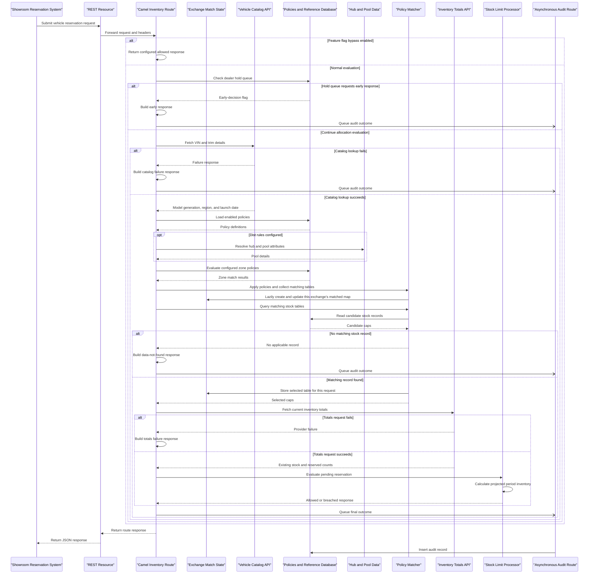

> Where its data comes from instead: it calls x.x.x.x:xx; the data lives in those systems (how the application flows, Camel routes).

Instead of this write what ths ip represents, a db, external server?

> once user has clicked any of the evidence hyperlink, they are scrolled down. Now they have to manually scroll up but a button should be given maybe.

TC should be verified even more, the first one seemed incorrect. The report in it's own, should be verified for inconsistencies.

> Status codes in fino are only 200, need to also show returnCode summary as well.

Business logic explainations should be more detailed, code should be analysed THAT well, explain in layman's terms properly.

Report should be based on the endpoints, all info should be shared in one section. corelations should be shown properly.

Try a different model, qwen3 or something else can be tried. Stuff captured from beyla MUST be corelated thoroughly with the code.

In camel, we need total routes.

> code starts from resource

all requests headers are set here and w call find customer

> camel route.xml 

and from here moved to rt1_findcustomer. headers are being set here, then some config value is read and then w check if flag is y, log will changed. for external calls, this is mentioned in the rt1_findcustomer based on conditions too.

exact line where cbs is hit, w call a ban in reequest processer.java > clientrestservice

wherever w are making a client, external call is being made 

iN headerapi.java

there are 6 cbs apis and 6 diff parameters are being sent

COUNT MUST REMAIN THE SAME THROUGHOUT THE REPORT

WE NEED TO FIND CLIENTS EVEN BETTER

WHY IS SONARQUBE NOT RUNNING: no podman or docker, so SonarQube cannot be started automatically. Install one, or run a server yourself and set $SONAR_URL. - WHY CAN'T SETUP.SH DO THIS?!

CODE ANALYSER DIAGRAM - Severity makes no sense, design related stuff is also mentioned. - ALSO .XML and other files arent being considered at all.

camel, pom, java code (2k lines of java class makes no sense, repeated calls should be flagged)

MASK IPs, even in codebases.

RETURN CODE SUMMARY, INGRESS EGRESS SUMMARY, etc.

Add section for modernisation & performance improvements kind of stuff. Section should show how many issues exist, static and llm based analysis for this!!!

Java doc comments cna be added ??? log printing is synced with code in fino, can be async? Less english and more focus on accurate facts, that corelate well within the code.

Samplers for beyla, check them

What even happens to the AST? is it even getting stored in db?

==============================================================

Is this architecture good for my codebase analyser? I feel like this was the missing block, all along. Thoroughly review this approach against the existing one.

Phase 0: Empty databases & schema should be created, all the data that's to be stored and how it's to be queried during after the analysis.

Phase 1: Static EXTRACTION - Camel routes.XML, application.properties, pom.xml, all java codes will have their content parsed using dedicated parers that we've already created. All facts will get stored in the postgresql database. I believe that data extraction and storage still needs to be perfected because I am not even sure if currently [deep pass phase] considers the AST or not.

Phase 2: LLM EXTRACTION - Every. Single. File., will be getting sent to the LLM for analysis. One by one, every file analysis will get stored in the db into a simple table with [file_path|llm_response]. With this, the file based llm extraction will be partially completed. Must be extremely detailed.

Phase 3: Static & LLM Corelation - Tricky but necessary for explaining the entire flow of the codebase. We must corelate the static & llm analysis and everything that's been found in the DB and document the bigger picture, thinking mode must be enabled for this and must ensure zero hallucination / burnt context window. MUST reconsider the existing prompts thoroughly before reaching here.

Phase 4: Documentation - Self-explanatory, prompts must be reconsidered thoroughly even here. The generated document must be simple enough for a new dev to understand and should act like a useful guide book for understanding. Holds the least priority, for now.

==================================================================

Problems

The model was given the wrong job. The deep pass sends a 26K-character prompt asking the model to turn Java into JSON: classes, methods, signatures, SQL. A parser does that better, cheaper and without inventing anything. Tree-sitter was already doing it in callflow. What the model is actually good at is explaining what code is for, and we only let it do that at the very end, over a sheet of counts. Your "analyse this file" test flipped that around, which is why it read better than the report. That result says the static work was being used in the wrong place, not that it isn't needed.
There are two records of the code, joined by name. Classes, methods and endpoints come from the model's JSON. The call graph comes from the syntax tree. The only link is name matching in chapters.py when the report is built. I checked the schema: callflow_nodes has class_fqcn, file and line, but no foreign key to classes or methods. A lot of v11–v15 went on reconciling the two:
the four getSudent endpoints
traffic from one WAR matched to another, and counts added twice
configure() reported as unreachable
Useful facts only exist while the report is being built. The pom/build facts, config rules, DDL and seed facts, the SQL explanations and the sequence diagrams are all computed at render time and then discarded. Nothing upstream can use them, the model included, and you can't query them.
The stage order stops the model seeing static facts. extract_deep runs before resolve, camel and capture. Even if we wanted to give the model the call graph, it doesn't exist yet at that point.
Several of my recent fixes treated symptoms. drop_pasted, the budgeted fact sheets and the retry when too much gets dropped all exist because we passed counts to a model and then told it not to repeat them. Give the model evidence tied to code locations instead of an inventory, and most of that scaffolding becomes unnecessary.

Possible solutions:
- Thinking mode needs to remain on at all times, time is not a constraint: we need quality output
- Your REFINED DESIGN is very high level and doesn't explain the exact flow of how this is supposed to happen: [Each call gets the file with line numbers plus that file's static outline: its symbols, callers and callees, the SQL it touches, the config keys it reads and its routes. The prompt is your "analyse this file" style plus the claims list.] - Similar issue is with others too.
- Please let's finalise the approach right away before we start so that you wouldn't have to think about them on the whim, while building the project. Please? Please let's also finalise the prompts right away, every single one that's to be used. 
- Inputs provided by the user like Beyla traffic must also get stored in the db AFTER cleaning (duplicate removal / kind of stuff already being done) and only THEN it should be used.
- Prepare a detailed and thorough document for approach, with the idea of following it strictly step-by-step during the code-writing process, instead of building solutions on the whim.

Analyse every file and thoroughly understand what's to be removed / changed in absolute detail. If you want to remove something with something better, do it. Nothing is set in stones and if the change only leads to a better output, it's worth it. Also, add this analysis to the prepared document from above.

- Sub-tool outputs are stored in the db or not?
- ast is stored or not?
- Generated guide / report must have content in bullet points
- Code quality analyser should also consider xml file & LLM should also give it's opinions on where the code can be made better in terms of performance and modernisation (like upgrading versions or using a new approach)
- Statically generated TCs should get analysed by the LLM and missing TCs should be added, considering how camel routes and code can have conditions too
- Additional Info User input text should also be allowed before the analysis is run, user should be allowed to update the system prompt and add whatever little they already know about the codebase. All prompts must be stored in a conf file so that it can be easily updated.

================================================================

1) give less english in summary.. ---> Bullet points ftw
2) try to restructure report with sections for unique ingress/egress (catch cbs endpoints..)
3) from static and beyla analysis..see if a list of unique non zero return code can be published along with responseMessage
4) provision of xml code analysis
5) see if in static analysis, cyclomatic complexity can be published (https://www.mccabe.com/iq_developers.htm) for each method
6) some auto recommendation of writing code comments

===============================================================================================

- Static Code flow is still incorrect and given how we are already uploading entire codebase to the LLM, can we not also compare the differences between the codeflow and adjucate between it? When I tell the LLM to "Go line by line, thoroughly and deeply and form perfect corelations and a deeper understanding and analysis of the codebase" and I am able to generate perfect diagrams from it. I feel like static portion is significantly damaging us. This activity shall help us understand how correct the static analysis even is. Can we do this please because I am tired of working on reports now. When I give the codebase and report format to llm directly they generate perfect reports but when I do it using the utility, the code understanding and explanation is muddled. Also - static codeflow must also go into the bean and understand what's happening at a deeper level. What I propose is, the static portion of the utility will run as it is but the same operations will also be performed by the LLM. At the end of the analysis, we shall be shown where the differences were and what the LLM found that the static portion couldn't or where the static portion was outright incorrect. The llm based codeflow shall be considered until the static portion starts giving 100% matches with the LLM analysis. 

- Code flow & business diagram is incorrect and seems to be having a wrong understanding of the code flow


ISSUES:

APPLICATION FLOW

Must display time elapsed logger

Side Panel / Heading
- Don't show [Not everything ran: SonarQube (failed); container runtime (failed). How this report was built]
- Instead of [ Understand it ], call it Onboarding Section
- Don't write [Scan SCAN-20261019-175627-34BFF0 · commit 1a2b3c4d5e (given with --commitId) Java 17 · Quarkus 3.6.01 business endpoint · 6 Camel routes35 files · 1,372 lines of JavaGenerated 19 Oct 2026 ] in lines - Instead have a table for it
- Heading shouldn't just be the name of the codebase. It should be something like: Codebase Analysis: Library Inventory System v1.0.0

## INTRODUCTION

NONE OF THE SECTIONS SHOULD GET CONFUSED BY THE BEYLA-TRAFFIC INPUT, IT'S ONLY TO BE USED BY THE TEST CASES SECTION!

Application In One Minute
- What's the use of putting [Nobody is asked to log in on 1 endpoint: who can call what.] in Who uses it
```
Who uses it	
    An upstream ESB or partner system (assumed from the /esb/ path prefix; the code does not name its callers) over HTTP JSON.
    Nobody is asked to log in on 1 endpoint: who can call what.
```
- This is wrong I think [Data in database (datasource default datasource), SQL Server ESB_Transactions on re.da.ct.ed2 (datasource esbDataSource), 1 table. Calls 1 outside system: re.da.ct.ed:xx.] in Technology. Are you sure 2 DBs are called?
- Major Findings must only show issues labeled as the peak SEVERITY level in the technical debt section. Clicking on [MORE DETAILS HERE →] should show redirect user to the debt section with filter set on the highest severity where these same issues could be seen.
- Every value in Major Findings should have a separate bullet point instead of being separated by semi-colon:
```
Major findings
    Medium Concurrent corruption of @ApplicationScoped lists/maps (FindCustomer.java:63, ReqProcessor1.java:56 ); HTTP 200 returned for both success and CamelExecutionException; no authentication or input validation; ${header.Method_ID} used in JDBC routing; manual JSON string concatenation; unencrypted database connection; in-memory seda: logging queue loses data on crash; 5 System.out.println calls in production code; 5 package-path mismatches. FindCustomer.java:63 chosen on purpose Details → Issue109
```

Questions this report answers
- This is a bit contradictory [ Can I trust the tests? - Not yet: the team wrote no automated tests, so nothing checks that a change keeps the behaviour. The generated suite adds 50 cases you can run (Test cases). ]
- In Where is the data kept > [MSSQL ESB_Transactions via esbDataSource (application.properties:41)] seems to be incorrect considering the app flow. Only logs in DB using the seda:dashboardlogging, are stored here using internal routing, the actual /esb/find/customers doesn't connect with any DB on it's own.

## How it works

SYSTEM DIAGRAM NEEDS TO HAVE BETTER DESCRIPTIONS. This same Description Text flows out of the boxes / bubbles when it's too much, model must print these correctly.

NONE OF THE SECTIONS SHOULD GET CONFUSED BY THE BEYLA-TRAFFIC INPUT, IT'S ONLY TO BE USED BY THE TEST CASES SECTION!

In [At a glance] Content and diagram could've been better, there seems to be incorrect information.

In [Request API], there seem to have missing status codes and crucial information

Every single section here seems to be having missing or incomplete or incorrect information. Nothing seems to be complete for some reason.

Code flow diagram should be more detailed and cover all flows, including the external calls that are made using internal routing.

In [Code flow diagram], the actual diagram area seems to be very large but it should be a bit smaller. If the user would like to view it, they'll expand it. Also - expand isn't working.

Extremely important for the codeflow diagram to be correct and it should be extremely detailed. Must show all the external calls made using the internal routing.

Business workflow sequence is extremely wrong, at the moment. It should not display code components in the blue boxes, it should show groups like this:


In [External systems and dependencies], don't show container diagram. Also the table should contain columns like:
```
| Dependency | Configuration property | Route and use | Request/context | Result used by this service |
|---|---|---|---|---|
| Vehicle catalog API | `Get_Vehicle_Catalog` | `FetchCatalogRoute`; invoked through `direct:FetchCatalog` | VIN prefix; forwards `X-AUTH-KEY` when supplied | Model 
generation, trim levels, launch date, and region code |
| Inventory & reservations API | `Get_Inventory_Totals` | `R_FindInventoryRoute`; invoked through `direct:FindInventory` | Dealer code, selected trim/channel, and model 
generation; forwards `X-AUTH-KEY` | Current daily/monthly/yearly showroom stock and reservation counts |
| SQL Server x datasource | `quarkus.datasource.xDataSource.*` | Policy, reference, stock-table, hub/pool, hold queue, and audit access | Configured through datasource 
properties | Policy configuration, decision inputs, and persisted audit rows |
```

This is said in the DATASTORE section and shown as if these 2 are different when seda is calling esb_transactions only:
```
    MSSQL ESB_Transactions: connection string re.da.ct.ed2/ESB_Transactions (application.properties:41); encrypt=false (application.properties:45).
    seda:dashboardlogging: in-memory queue; data lost on restart/crash.
```

5 Run & operate > Camel Routes should be mvoed into [ 3 Dependencies, data & configuration ]

Should remove [ Cross-cutting concerns ] and should move [ EXPLORE CODEBASE ] into [ 3 Dependencies, data & configuration ]

Glossary seems to be very empty and useless. Why are certain @ or annotations being covered but not the rest? What decides whether something will make it into the glossary section?

7Database interactions section should be moved here directly into [ 3 Dependencies, data & configuration ]

## Test Cases

No need to show ×184 Requests at all in the table

{{BASE_URL}} should always be set as the base_url from the beyla-traffic for that endpoint.

Please review the test cases thoroughly

## Technical Debt 

### Findings

Findings Table should have default 5 rows opened not 10.

SEVERITY LEVELS MAKE NO SENSE, 3 SAME LOOKING ISSUE GET MARKED AS CRITICAL, HIGH, MEDIUM.

remove symbol column

issues aren't very clear: "NM_METHOD_NAMING_CONVENTION", "UUF_UNUSED_FIELD", "Known vulnerability in com.fasterxml.jackson.core:jackson-core:2.15.3: GHSA-72hv-8253-57qq, GHSA-7hhh-6rmp-j9qf, GHSA-r7wm-3cxj-wff9", 0 issues shown for security & performance, 

[153 findings in 28 files, from config, console check, cpd, credentials check, database check, dependency check, javac, json check, model review, modernisation review, outbound check, package check, performance rules, pmd, risk review, spotbugs, sql check; 36 of them housekeeping (info), sorted last.] description is too long, remove it entirely - makes no sense.

This makes no sense to me, why is this even an issue and why is there no file location mentioned for it. Also why was Issue2 shown in row 1:
```
#1 Issue2	highpattern matched	Reliabilitydependencies	+—	dependencies	Known vulnerability in com.fasterxml.jackson.core:jackson-core:2.15.3: GHSA-72hv-8253-57qq, GHSA-7hhh-6rmp-j9qf, GHSA-r7wm-3cxj-wff9dependency-vulnerability	dependency check
```

[ —, 34 issues, in — ] category in the files tab should not even be here but is simply here because of the issue above. It doesn't mention any files too so "—" got shown as a file. 

None of the MAJOR FINDINGS from introduction are present in the CRITICAL or HIGH category filter

Improvements and best practices should've been more maybe?

## SECURITY

Instead of the The analyst's verdict, have SUMMARY section with bullet points, generically covering all issues. Refer the security findings in Technical Debt > Findings > Security category and the OWASP and model based findings as well.

Findings > Just like how we are showing [ Details → Issue109] for each issue in INTRODUCTION>MAJOR FINDINGS, we should allow user to view the finding being discussed here

OWASP Security Guideline Compliance should have been a part of the TECHNICAL DEBT's findings table. It should not be shown here separately. LLM should display it there along with the suggested fixes, like we are doing for all other issues.

Remove Who can call what, Threats per element, OWASP Security Guideline Compliance

## PERFORMANCE

Change heading to Performance

Findings > Just like how we are showing [ Details → Issue109] for each issue in INTRODUCTION>MAJOR FINDINGS, we should allow user to view the finding being discussed here

No need for the diagram here

Findings only shown in Performance>Where the costs sit on the flow should get shown in the Technical Debt>findings table

==============

Thoroughly analyse /root/quarkus_ruleengine_merchant_transactionlimit line by line. Form perfect corelations and a complete codeflow of the entire codebase by traversing every area. Perform a deep analysis of how everything is working and flowing, do not leave any stones unturned. Once done, respond with DONE. Take as much time as you want, but be completely sure of your analysis.

I want you to thoroughly and deeply review the code-flow shown in /root/war-analyzer/out/static.json against your understanding of the /root/quarkus_ruleengine_merchant_transactionlimit. Be absolutely thorough and do not leave any gaps. Criticise freely and deeply, do not hold back. Make sure your deep understanding of the codeflow matches with this json that has been generted by my utility. Take as much time as you want, be thorough and complete in your analysis, do not rush. Once done, output your analysis to /static_json_deep_review.md.